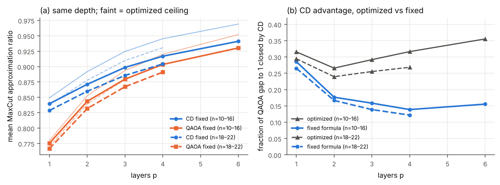
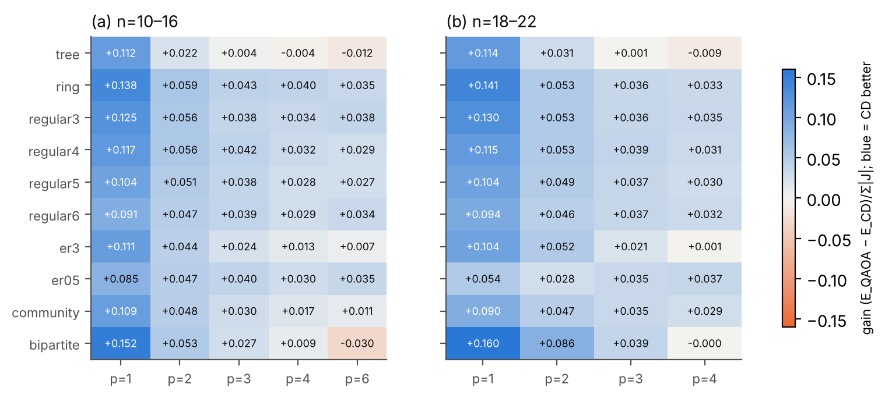
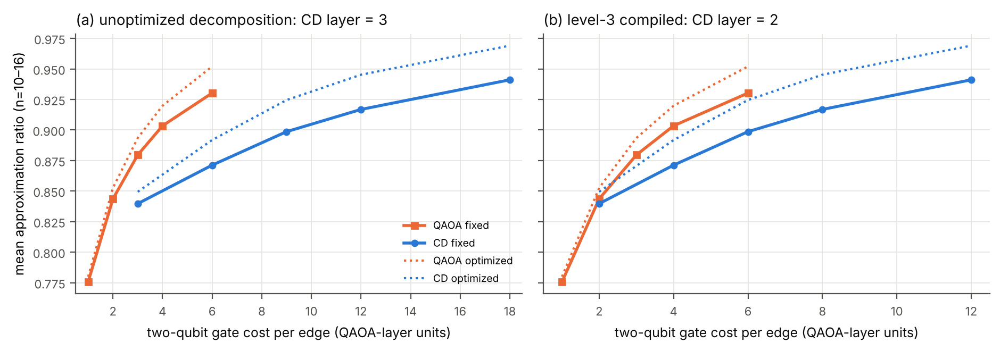
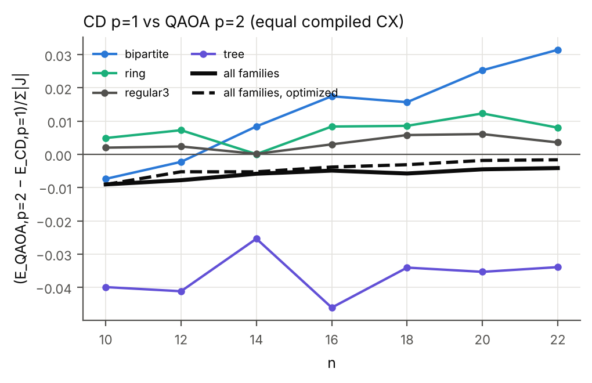
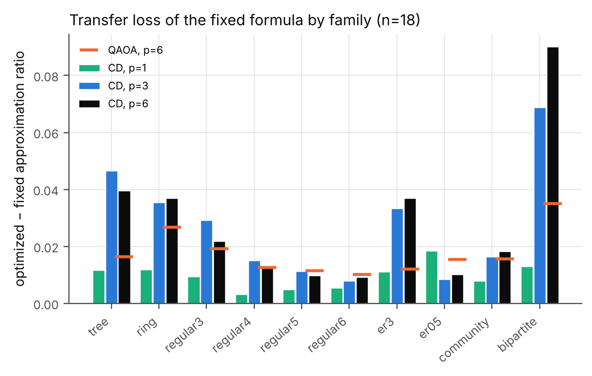
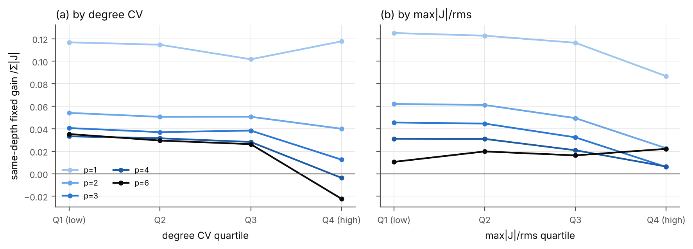
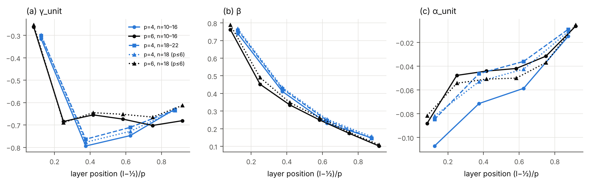
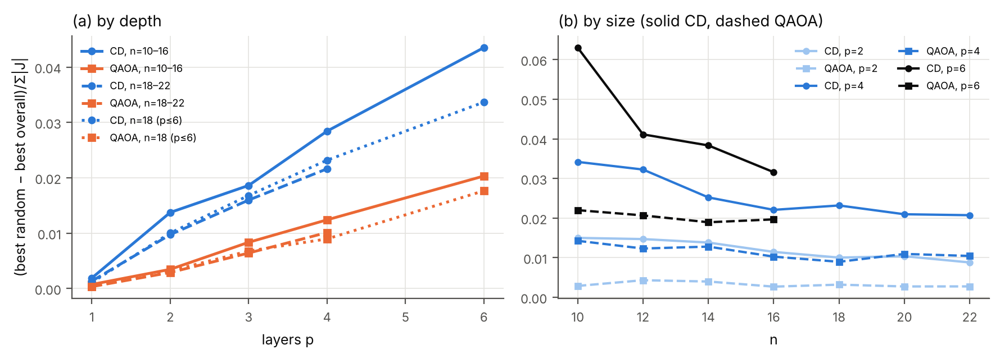

# Equal-depth CD-QAOA GPU study — analysis report

Generated by `analysis/analyze_eqdepth.py`. gain = (E_QAOA − E_CD)/Σ|J| (positive favours CD); ratio = MaxCut approximation ratio (exact extrema). CIs: instance bootstrap, 95%.

## 1. Data

### T1. Data sets and optimisation effort

`tables/T1_dataset.csv`

| run               | n           | depths    |   families |   weights |   train |   val |   test |   optimizations |   not_converged_% |   gpu_slot_hours |   cd_opt_worse_than_qaoa_opt |
|:------------------|:------------|:----------|-----------:|----------:|--------:|------:|-------:|----------------:|------------------:|-----------------:|-----------------------------:|
| eqdepth_small_N20 | 10,12,14,16 | 1,2,3,4,6 |         10 |         5 |    4000 |  2000 |   4000 |          320000 |              3.18 |           301.22 |                            0 |
| eqdepth_large_N20 | 18,20,22    | 1,2,3,4   |         10 |         5 |    3000 |  1500 |   3000 |          192000 |              3.70 |           239.85 |                            0 |
| eqdepth_n18p6_N20 | 18          | 1,2,3,4,6 |         10 |         5 |    1000 |   500 |   1000 |           80000 |              3.66 |           124.46 |                            0 |

## 2. Same depth

### T2. Same depth: fixed formula (test) and optimized ceiling (train)

`tables/T2_same_depth.csv`

| run   |   p |   pairs |   gain_fixed |   ci_lo |   ci_hi |   cd_win |   ratio_qaoa_fixed |   ratio_cd_fixed |   ratio_qaoa_opt |   ratio_cd_opt |   gain_opt_norm |   gap_closed_fixed |   gap_closed_opt |   captured_by_formula |
|:------|----:|--------:|-------------:|--------:|--------:|---------:|-------------------:|-----------------:|-----------------:|---------------:|----------------:|-------------------:|-----------------:|----------------------:|
| small |   1 |    4000 |       0.1143 |  0.1127 |  0.1157 |   0.9822 |             0.7756 |           0.8397 |           0.7799 |         0.8494 |          0.1244 |             0.2857 |           0.3157 |                0.9225 |
| small |   2 |    4000 |       0.0482 |  0.0466 |  0.0498 |   0.9167 |             0.8436 |           0.8712 |           0.8527 |         0.8918 |          0.0701 |             0.1766 |           0.2658 |                0.7051 |
| small |   3 |    4000 |       0.0327 |  0.0309 |  0.0344 |   0.9058 |             0.8796 |           0.8987 |           0.8935 |         0.9246 |          0.0559 |             0.1584 |           0.2918 |                0.6136 |
| small |   4 |    4000 |       0.0228 |  0.0211 |  0.0244 |   0.8950 |             0.9035 |           0.9169 |           0.9199 |         0.9453 |          0.0458 |             0.1387 |           0.3165 |                0.5284 |
| small |   6 |    4000 |       0.0172 |  0.0149 |  0.0194 |   0.8130 |             0.9303 |           0.9411 |           0.9521 |         0.9691 |          0.0309 |             0.1554 |           0.3552 |                0.6363 |
| large |   1 |    3000 |       0.1108 |  0.1093 |  0.1122 |   0.9933 |             0.7668 |           0.8287 |           0.7705 |         0.8381 |          0.1207 |             0.2653 |           0.2945 |                0.9154 |
| large |   2 |    3000 |       0.0497 |  0.0482 |  0.0512 |   0.9407 |             0.8319 |           0.8599 |           0.8394 |         0.8779 |          0.0689 |             0.1667 |           0.2395 |                0.7287 |
| large |   3 |    3000 |       0.0314 |  0.0296 |  0.0332 |   0.8930 |             0.8673 |           0.8857 |           0.8789 |         0.9098 |          0.0557 |             0.1387 |           0.2553 |                0.5954 |
| large |   4 |    3000 |       0.0218 |  0.0200 |  0.0236 |   0.8683 |             0.8910 |           0.9042 |           0.9054 |         0.9308 |          0.0459 |             0.1219 |           0.2684 |                0.5231 |
| n18p6 |   1 |    1000 |       0.1119 |  0.1094 |  0.1145 |   0.9940 |             0.7681 |           0.8306 |           0.7723 |         0.8403 |          0.1216 |             0.2697 |           0.2988 |                0.9193 |
| n18p6 |   2 |    1000 |       0.0498 |  0.0472 |  0.0526 |   0.9220 |             0.8341 |           0.8624 |           0.8421 |         0.8802 |          0.0683 |             0.1706 |           0.2416 |                0.7419 |
| n18p6 |   3 |    1000 |       0.0237 |  0.0204 |  0.0269 |   0.8590 |             0.8707 |           0.8850 |           0.8818 |         0.9122 |          0.0548 |             0.1106 |           0.2576 |                0.4693 |
| n18p6 |   4 |    1000 |       0.0143 |  0.0104 |  0.0181 |   0.8390 |             0.8941 |           0.9033 |           0.9080 |         0.9328 |          0.0447 |             0.0870 |           0.2697 |                0.3711 |
| n18p6 |   6 |    1000 |       0.0113 |  0.0069 |  0.0154 |   0.8200 |             0.9226 |           0.9300 |           0.9401 |         0.9586 |          0.0335 |             0.0955 |           0.3083 |                0.4003 |

### T3. Same-depth fixed gain by family (mean E/Σ|J|)

`tables/T3_gain_by_family.csv`

| run   | value     |     p1 |     p2 |      p3 |      p4 |       p6 |
|:------|:----------|-------:|-------:|--------:|--------:|---------:|
| large | tree      | 0.1143 | 0.0311 |  0.0006 | -0.0094 | nan      |
| large | ring      | 0.1413 | 0.0527 |  0.0356 |  0.0331 | nan      |
| large | regular3  | 0.1298 | 0.0532 |  0.0363 |  0.0347 | nan      |
| large | regular4  | 0.1146 | 0.0529 |  0.0391 |  0.0313 | nan      |
| large | regular5  | 0.1045 | 0.0489 |  0.0368 |  0.0296 | nan      |
| large | regular6  | 0.0939 | 0.0457 |  0.0369 |  0.0321 | nan      |
| large | er3       | 0.1044 | 0.0516 |  0.0210 |  0.0011 | nan      |
| large | er05      | 0.0543 | 0.0279 |  0.0346 |  0.0371 | nan      |
| large | community | 0.0902 | 0.0473 |  0.0346 |  0.0286 | nan      |
| large | bipartite | 0.1602 | 0.0857 |  0.0389 | -0.0005 | nan      |
| n18p6 | tree      | 0.1195 | 0.0208 | -0.0178 | -0.0253 |  -0.0130 |
| n18p6 | ring      | 0.1408 | 0.0622 |  0.0266 |  0.0344 |   0.0401 |
| n18p6 | regular3  | 0.1306 | 0.0582 |  0.0276 |  0.0265 |   0.0273 |
| n18p6 | regular4  | 0.1153 | 0.0527 |  0.0323 |  0.0282 |   0.0266 |
| n18p6 | regular5  | 0.1053 | 0.0503 |  0.0339 |  0.0293 |   0.0282 |
| n18p6 | regular6  | 0.0932 | 0.0483 |  0.0347 |  0.0286 |   0.0258 |
| n18p6 | er3       | 0.1070 | 0.0477 |  0.0101 | -0.0131 |  -0.0187 |
| n18p6 | er05      | 0.0603 | 0.0344 |  0.0356 |  0.0329 |   0.0272 |
| n18p6 | community | 0.0929 | 0.0477 |  0.0260 |  0.0214 |   0.0181 |
| n18p6 | bipartite | 0.1545 | 0.0761 |  0.0281 | -0.0196 |  -0.0487 |
| small | tree      | 0.1116 | 0.0223 |  0.0039 | -0.0037 |  -0.0124 |
| small | ring      | 0.1376 | 0.0586 |  0.0432 |  0.0403 |   0.0345 |
| small | regular3  | 0.1253 | 0.0561 |  0.0384 |  0.0342 |   0.0376 |
| small | regular4  | 0.1172 | 0.0558 |  0.0421 |  0.0319 |   0.0286 |
| small | regular5  | 0.1040 | 0.0510 |  0.0384 |  0.0278 |   0.0273 |
| small | regular6  | 0.0909 | 0.0465 |  0.0391 |  0.0287 |   0.0340 |
| small | er3       | 0.1107 | 0.0442 |  0.0244 |  0.0130 |   0.0065 |
| small | er05      | 0.0848 | 0.0468 |  0.0403 |  0.0297 |   0.0351 |
| small | community | 0.1088 | 0.0482 |  0.0301 |  0.0168 |   0.0111 |
| small | bipartite | 0.1517 | 0.0525 |  0.0269 |  0.0093 |  -0.0303 |

### T3. Same-depth fixed gain by weight_kind (mean E/Σ|J|)

`tables/T3_gain_by_weight_kind.csv`

| run   | value      |     p1 |     p2 |      p3 |      p4 |       p6 |
|:------|:-----------|-------:|-------:|--------:|--------:|---------:|
| large | unit       | 0.1176 | 0.0582 |  0.0456 |  0.0315 | nan      |
| large | uniform    | 0.1201 | 0.0611 |  0.0456 |  0.0318 | nan      |
| large | bimodal    | 0.1200 | 0.0606 |  0.0426 |  0.0285 | nan      |
| large | lognormal  | 0.1092 | 0.0504 |  0.0329 |  0.0245 | nan      |
| large | heavy_tail | 0.0869 | 0.0183 | -0.0096 | -0.0074 | nan      |
| n18p6 | unit       | 0.1194 | 0.0640 |  0.0443 |  0.0282 |   0.0167 |
| n18p6 | uniform    | 0.1226 | 0.0659 |  0.0419 |  0.0263 |   0.0150 |
| n18p6 | bimodal    | 0.1186 | 0.0599 |  0.0345 |  0.0194 |   0.0117 |
| n18p6 | lognormal  | 0.1103 | 0.0494 |  0.0243 |  0.0161 |   0.0148 |
| n18p6 | heavy_tail | 0.0889 | 0.0100 | -0.0265 | -0.0184 |  -0.0017 |
| small | unit       | 0.1260 | 0.0627 |  0.0456 |  0.0316 |   0.0127 |
| small | uniform    | 0.1256 | 0.0617 |  0.0443 |  0.0304 |   0.0163 |
| small | bimodal    | 0.1265 | 0.0604 |  0.0437 |  0.0293 |   0.0179 |
| small | lognormal  | 0.1111 | 0.0472 |  0.0321 |  0.0217 |   0.0197 |
| small | heavy_tail | 0.0821 | 0.0091 | -0.0024 |  0.0009 |   0.0196 |

### T3. Same-depth fixed gain by n (mean E/Σ|J|)

`tables/T3_gain_by_n.csv`

| run   |   value |     p1 |     p2 |     p3 |     p4 |       p6 |
|:------|--------:|-------:|-------:|-------:|-------:|---------:|
| large |      18 | 0.1121 | 0.0504 | 0.0310 | 0.0213 | nan      |
| large |      20 | 0.1102 | 0.0498 | 0.0332 | 0.0236 | nan      |
| large |      22 | 0.1100 | 0.0489 | 0.0301 | 0.0204 | nan      |
| n18p6 |      18 | 0.1119 | 0.0498 | 0.0237 | 0.0143 |   0.0113 |
| small |      10 | 0.1180 | 0.0495 | 0.0342 | 0.0247 |   0.0224 |
| small |      12 | 0.1125 | 0.0478 | 0.0327 | 0.0229 |   0.0182 |
| small |      14 | 0.1131 | 0.0472 | 0.0311 | 0.0215 |   0.0153 |
| small |      16 | 0.1133 | 0.0483 | 0.0327 | 0.0220 |   0.0130 |

## 3. Equal two-qubit budget

### T4. Paired comparisons at matched two-qubit budget (gain>0 favours CD)

`tables/T4_equal_budget.csv`

| run   | source            |   cd_p |   qaoa_p | matching            |    gain |   ci_lo |   ci_hi |   cd_win |   pairs |
|:------|:------------------|-------:|---------:|:--------------------|--------:|--------:|--------:|---------:|--------:|
| small | fixed (test)      |      1 |        2 | compiled level-3 CX | -0.0069 | -0.0081 | -0.0057 |   0.4145 |    4000 |
| small | fixed (test)      |      1 |        3 | unoptimized CX      | -0.0712 | -0.0725 | -0.0699 |   0.0127 |    4000 |
| small | fixed (test)      |      2 |        4 | compiled level-3 CX | -0.0587 | -0.0605 | -0.0570 |   0.0147 |    4000 |
| small | fixed (test)      |      2 |        6 | unoptimized CX      | -0.1080 | -0.1103 | -0.1056 |   0.0010 |    4000 |
| small | fixed (test)      |      3 |        6 | compiled level-3 CX | -0.0592 | -0.0617 | -0.0566 |   0.0725 |    4000 |
| large | fixed (test)      |      1 |        2 | compiled level-3 CX | -0.0048 | -0.0059 | -0.0037 |   0.4220 |    3000 |
| large | fixed (test)      |      1 |        3 | unoptimized CX      | -0.0679 | -0.0690 | -0.0669 |   0.0027 |    3000 |
| large | fixed (test)      |      2 |        4 | compiled level-3 CX | -0.0562 | -0.0577 | -0.0548 |   0.0047 |    3000 |
| n18p6 | fixed (test)      |      1 |        2 | compiled level-3 CX | -0.0054 | -0.0073 | -0.0035 |   0.3920 |    1000 |
| n18p6 | fixed (test)      |      1 |        3 | unoptimized CX      | -0.0709 | -0.0729 | -0.0691 |   0.0010 |    1000 |
| n18p6 | fixed (test)      |      2 |        4 | compiled level-3 CX | -0.0580 | -0.0610 | -0.0551 |   0.0020 |    1000 |
| n18p6 | fixed (test)      |      2 |        6 | unoptimized CX      | -0.1092 | -0.1129 | -0.1055 |   0.0000 |    1000 |
| n18p6 | fixed (test)      |      3 |        6 | compiled level-3 CX | -0.0698 | -0.0744 | -0.0655 |   0.0000 |    1000 |
| small | optimized (train) |      1 |        1 | same depth          |  0.1244 |  0.1231 |  0.1257 |   1.0000 |    4000 |
| small | optimized (train) |      1 |        2 | compiled level-3 CX | -0.0058 | -0.0066 | -0.0051 |   0.4027 |    4000 |
| small | optimized (train) |      1 |        3 | unoptimized CX      | -0.0790 | -0.0800 | -0.0781 |   0.0003 |    4000 |
| small | optimized (train) |      2 |        2 | same depth          |  0.0701 |  0.0691 |  0.0710 |   1.0000 |    4000 |
| small | optimized (train) |      2 |        4 | compiled level-3 CX | -0.0505 | -0.0512 | -0.0498 |   0.0005 |    4000 |
| small | optimized (train) |      2 |        6 | unoptimized CX      | -0.1082 | -0.1095 | -0.1070 |   0.0000 |    4000 |
| small | optimized (train) |      3 |        3 | same depth          |  0.0559 |  0.0550 |  0.0567 |   1.0000 |    4000 |
| small | optimized (train) |      3 |        6 | compiled level-3 CX | -0.0493 | -0.0500 | -0.0486 |   0.0015 |    4000 |
| small | optimized (train) |      4 |        4 | same depth          |  0.0458 |  0.0449 |  0.0466 |   0.9998 |    4000 |
| small | optimized (train) |      6 |        6 | same depth          |  0.0309 |  0.0302 |  0.0315 |   0.9930 |    4000 |
| large | optimized (train) |      1 |        1 | same depth          |  0.1207 |  0.1194 |  0.1220 |   1.0000 |    3000 |
| large | optimized (train) |      1 |        2 | compiled level-3 CX | -0.0022 | -0.0029 | -0.0015 |   0.4733 |    3000 |
| large | optimized (train) |      1 |        3 | unoptimized CX      | -0.0730 | -0.0740 | -0.0721 |   0.0000 |    3000 |
| large | optimized (train) |      2 |        2 | same depth          |  0.0689 |  0.0679 |  0.0701 |   1.0000 |    3000 |
| large | optimized (train) |      2 |        4 | compiled level-3 CX | -0.0494 | -0.0501 | -0.0487 |   0.0003 |    3000 |
| large | optimized (train) |      3 |        3 | same depth          |  0.0557 |  0.0546 |  0.0568 |   1.0000 |    3000 |
| large | optimized (train) |      4 |        4 | same depth          |  0.0459 |  0.0449 |  0.0469 |   1.0000 |    3000 |
| n18p6 | optimized (train) |      1 |        1 | same depth          |  0.1216 |  0.1193 |  0.1239 |   1.0000 |    1000 |
| n18p6 | optimized (train) |      1 |        2 | compiled level-3 CX | -0.0031 | -0.0044 | -0.0018 |   0.4590 |    1000 |
| n18p6 | optimized (train) |      1 |        3 | unoptimized CX      | -0.0742 | -0.0759 | -0.0725 |   0.0000 |    1000 |
| n18p6 | optimized (train) |      2 |        2 | same depth          |  0.0683 |  0.0665 |  0.0702 |   1.0000 |    1000 |
| n18p6 | optimized (train) |      2 |        4 | compiled level-3 CX | -0.0498 | -0.0511 | -0.0486 |   0.0000 |    1000 |
| n18p6 | optimized (train) |      2 |        6 | unoptimized CX      | -0.1075 | -0.1100 | -0.1052 |   0.0000 |    1000 |
| n18p6 | optimized (train) |      3 |        3 | same depth          |  0.0548 |  0.0531 |  0.0565 |   1.0000 |    1000 |
| n18p6 | optimized (train) |      3 |        6 | compiled level-3 CX | -0.0499 | -0.0512 | -0.0488 |   0.0010 |    1000 |
| n18p6 | optimized (train) |      4 |        4 | same depth          |  0.0447 |  0.0433 |  0.0463 |   1.0000 |    1000 |
| n18p6 | optimized (train) |      6 |        6 | same depth          |  0.0335 |  0.0323 |  0.0348 |   1.0000 |    1000 |

### T5. CD p=1 vs QAOA p=2 (equal compiled CX) by n and family

`tables/T5_cd1_vs_qaoa2_by_n.csv`

| family    |      10 |      12 |      14 |      16 |      18 |      20 |      22 |
|:----------|--------:|--------:|--------:|--------:|--------:|--------:|--------:|
| tree      | -0.0399 | -0.0412 | -0.0254 | -0.0461 | -0.0341 | -0.0353 | -0.0339 |
| ring      |  0.0049 |  0.0073 |  0.0001 |  0.0084 |  0.0086 |  0.0123 |  0.0080 |
| regular3  |  0.0020 |  0.0024 |  0.0002 |  0.0030 |  0.0058 |  0.0061 |  0.0036 |
| regular4  |  0.0008 |  0.0021 |  0.0026 |  0.0027 |  0.0020 |  0.0029 |  0.0015 |
| regular5  | -0.0058 | -0.0027 | -0.0005 | -0.0006 | -0.0014 |  0.0002 | -0.0008 |
| regular6  | -0.0147 | -0.0087 | -0.0050 | -0.0028 | -0.0053 | -0.0053 | -0.0036 |
| er3       | -0.0116 | -0.0127 | -0.0125 | -0.0092 | -0.0131 | -0.0152 | -0.0090 |
| er05      | -0.0070 | -0.0120 | -0.0129 | -0.0156 | -0.0239 | -0.0271 | -0.0288 |
| community | -0.0117 | -0.0099 | -0.0133 | -0.0061 | -0.0117 | -0.0088 | -0.0097 |
| bipartite | -0.0074 | -0.0023 |  0.0084 |  0.0175 |  0.0157 |  0.0253 |  0.0315 |
| ALL       | -0.0090 | -0.0078 | -0.0058 | -0.0049 | -0.0057 | -0.0045 | -0.0041 |

### T5b. CD p=1 vs QAOA p=2, optimized (train, best of 8), by n and family

`tables/T5b_cd1_vs_qaoa2_by_n_optimized.csv`

| family    |      10 |      12 |      14 |      16 |      18 |      20 |      22 |
|:----------|--------:|--------:|--------:|--------:|--------:|--------:|--------:|
| tree      | -0.0289 | -0.0253 | -0.0262 | -0.0224 | -0.0273 | -0.0255 | -0.0210 |
| ring      |  0.0016 | -0.0007 | -0.0006 |  0.0040 |  0.0034 |  0.0034 |  0.0046 |
| regular3  | -0.0014 | -0.0015 |  0.0015 | -0.0008 |  0.0020 |  0.0005 |  0.0003 |
| regular4  |  0.0004 |  0.0024 |  0.0025 | -0.0004 |  0.0008 |  0.0026 |  0.0010 |
| regular5  | -0.0041 | -0.0001 | -0.0014 | -0.0000 |  0.0015 |  0.0015 |  0.0024 |
| regular6  | -0.0086 | -0.0043 | -0.0035 | -0.0015 |  0.0014 |  0.0009 |  0.0014 |
| er3       | -0.0126 | -0.0106 | -0.0110 | -0.0099 | -0.0098 | -0.0071 | -0.0084 |
| er05      | -0.0100 | -0.0086 | -0.0111 | -0.0088 | -0.0086 | -0.0085 | -0.0090 |
| community | -0.0179 | -0.0050 | -0.0097 | -0.0079 | -0.0076 | -0.0052 | -0.0069 |
| bipartite | -0.0091 |  0.0014 |  0.0070 |  0.0096 |  0.0133 |  0.0192 |  0.0192 |
| ALL       | -0.0091 | -0.0052 | -0.0052 | -0.0038 | -0.0031 | -0.0018 | -0.0016 |

### T5c. CD win rate, CD p=1 vs QAOA p=2, optimized

`tables/T5c_cd1_vs_qaoa2_winrate_optimized.csv`

| family    |     10 |     12 |     14 |     16 |     18 |     20 |     22 |
|:----------|-------:|-------:|-------:|-------:|-------:|-------:|-------:|
| tree      | 0.2200 | 0.2400 | 0.2100 | 0.1600 | 0.1000 | 0.1400 | 0.1600 |
| ring      | 0.5700 | 0.6200 | 0.6000 | 0.5600 | 0.6000 | 0.6200 | 0.6400 |
| regular3  | 0.4800 | 0.5000 | 0.6000 | 0.5100 | 0.6400 | 0.5900 | 0.6200 |
| regular4  | 0.4900 | 0.6600 | 0.6500 | 0.6500 | 0.6400 | 0.6700 | 0.6800 |
| regular5  | 0.2500 | 0.5900 | 0.5900 | 0.6400 | 0.6900 | 0.6800 | 0.7000 |
| regular6  | 0.1200 | 0.2300 | 0.3100 | 0.4900 | 0.6200 | 0.6700 | 0.6900 |
| er3       | 0.3000 | 0.3200 | 0.3000 | 0.3100 | 0.2700 | 0.4100 | 0.2700 |
| er05      | 0.2300 | 0.1900 | 0.0600 | 0.1100 | 0.0700 | 0.0700 | 0.0500 |
| community | 0.2200 | 0.3200 | 0.2900 | 0.2700 | 0.2200 | 0.2300 | 0.1500 |
| bipartite | 0.4500 | 0.5500 | 0.6200 | 0.6300 | 0.7400 | 0.7700 | 0.8000 |
| ALL       | 0.3330 | 0.4220 | 0.4230 | 0.4330 | 0.4590 | 0.4850 | 0.4760 |

## 4. Where the fixed formula loses

### T6. CD transfer loss = optimized ratio (train) − fixed-formula ratio (test), by family

`tables/T6_transfer_loss_cd.csv`

| family    |   large_p1 |   large_p2 |   large_p3 |   large_p4 |   small_p1 |   small_p2 |   small_p3 |   small_p4 |   small_p6 |
|:----------|-----------:|-----------:|-----------:|-----------:|-----------:|-----------:|-----------:|-----------:|-----------:|
| tree      |     0.0162 |     0.0288 |     0.0433 |     0.0438 |     0.0230 |     0.0407 |     0.0494 |     0.0512 |     0.0472 |
| ring      |     0.0149 |     0.0302 |     0.0347 |     0.0341 |     0.0163 |     0.0291 |     0.0362 |     0.0416 |     0.0513 |
| regular3  |     0.0053 |     0.0173 |     0.0203 |     0.0192 |     0.0075 |     0.0178 |     0.0202 |     0.0175 |     0.0180 |
| regular4  |     0.0042 |     0.0111 |     0.0124 |     0.0139 |     0.0041 |     0.0121 |     0.0128 |     0.0134 |     0.0152 |
| regular5  |     0.0048 |     0.0102 |     0.0108 |     0.0126 |     0.0022 |     0.0078 |     0.0101 |     0.0126 |     0.0136 |
| regular6  |     0.0043 |     0.0067 |     0.0060 |     0.0073 |     0.0042 |     0.0061 |     0.0061 |     0.0075 |     0.0073 |
| er3       |     0.0090 |     0.0142 |     0.0265 |     0.0309 |     0.0062 |     0.0182 |     0.0265 |     0.0299 |     0.0269 |
| er05      |     0.0188 |     0.0147 |     0.0067 |     0.0047 |     0.0051 |     0.0066 |     0.0081 |     0.0106 |     0.0095 |
| community |     0.0061 |     0.0085 |     0.0101 |     0.0122 |     0.0114 |     0.0202 |     0.0260 |     0.0298 |     0.0271 |
| bipartite |     0.0104 |     0.0380 |     0.0708 |     0.0866 |     0.0170 |     0.0471 |     0.0634 |     0.0698 |     0.0636 |

### T7. Permutation importance of graph features for the same-depth fixed gain (gradient boosting; 5-fold CV R² = p1: 0.72, p2: 0.51, p3: 0.29, p4: 0.17, p6: 0.14)

`tables/T7_feature_importance.csv`

| feature                |     p1 |     p2 |     p3 |     p4 |     p6 |
|:-----------------------|-------:|-------:|-------:|-------:|-------:|
| degree CV              | 0.0674 | 0.0630 | 0.1814 | 0.3613 | 1.3283 |
| weight CV              | 0.3829 | 0.5712 | 1.1618 | 0.5841 | 0.1183 |
| mean degree            | 0.2652 | 0.9174 | 0.3285 | 0.1026 | 0.1142 |
| clustering             | 0.6972 | 0.0564 | 0.0538 | 0.0361 | 0.1058 |
| algebraic connectivity | 0.0394 | 0.0488 | 0.0488 | 0.0381 | 0.4570 |
| max|J|/rms             | 0.0187 | 0.0997 | 0.1617 | 0.3024 | 0.1203 |
| weight skew            | 0.1762 | 0.2076 | 0.2876 | 0.2642 | 0.1733 |
| bipartite              | 0.1401 | 0.0463 | 0.0025 | 0.0033 | 0.0477 |
| density                | 0.0940 | 0.0087 | 0.0562 | 0.0660 | 0.0225 |
| n                      | 0.0319 | 0.0087 | 0.0032 | 0.0028 | 0.0105 |
| min degree             | 0.0010 | 0.0072 | 0.0041 | 0.0026 | 0.0089 |

### T8. Same-depth fixed gain by heterogeneity quartile (n=10–22)

`tables/T8_gain_by_heterogeneity_quartile.csv`

| feature    | quartile   |     p1 |     p2 |     p3 |      p4 |      p6 |
|:-----------|:-----------|-------:|-------:|-------:|--------:|--------:|
| degree CV  | Q1 (low)   | 0.1168 | 0.0541 | 0.0407 |  0.0333 |  0.0353 |
| degree CV  | Q2         | 0.1147 | 0.0506 | 0.0370 |  0.0316 |  0.0295 |
| degree CV  | Q3         | 0.1018 | 0.0507 | 0.0384 |  0.0283 |  0.0263 |
| degree CV  | Q4 (high)  | 0.1177 | 0.0400 | 0.0125 | -0.0036 | -0.0223 |
| max|J|/rms | Q1 (low)   | 0.1251 | 0.0621 | 0.0456 |  0.0311 |  0.0106 |
| max|J|/rms | Q2         | 0.1227 | 0.0611 | 0.0446 |  0.0310 |  0.0198 |
| max|J|/rms | Q3         | 0.1164 | 0.0494 | 0.0324 |  0.0209 |  0.0163 |
| max|J|/rms | Q4 (high)  | 0.0867 | 0.0227 | 0.0060 |  0.0064 |  0.0221 |

## 5. Angle templates and optimisation

### T9. Frozen CD angle table (run small, medoid template; γ = γ_unit·f_D(D)/s_J, α = α_unit/s_J·(D/D0)^−0.5)

`tables/T9_cd_template_small.csv`

|   p |   layer |   gamma_unit |    beta |   alpha_unit |
|----:|--------:|-------------:|--------:|-------------:|
|   1 |       1 |     -0.49066 | 0.47661 |     -0.16058 |
|   2 |       1 |     -0.40618 | 0.61284 |     -0.12223 |
|   2 |       2 |     -0.88334 | 0.22080 |     -0.03250 |
|   3 |       1 |     -0.35373 | 0.69606 |     -0.11448 |
|   3 |       2 |     -0.85542 | 0.32189 |     -0.07220 |
|   3 |       3 |     -0.69192 | 0.16208 |     -0.02048 |
|   4 |       1 |     -0.31501 | 0.73982 |     -0.10713 |
|   4 |       2 |     -0.79375 | 0.41159 |     -0.07139 |
|   4 |       3 |     -0.74736 | 0.23109 |     -0.05864 |
|   4 |       4 |     -0.62938 | 0.14796 |     -0.01487 |
|   6 |       1 |     -0.26216 | 0.76238 |     -0.08812 |
|   6 |       2 |     -0.68431 | 0.45194 |     -0.04773 |
|   6 |       3 |     -0.65482 | 0.33489 |     -0.04409 |
|   6 |       4 |     -0.67365 | 0.24960 |     -0.04192 |
|   6 |       5 |     -0.70202 | 0.17346 |     -0.03156 |
|   6 |       6 |     -0.68076 | 0.10186 |     -0.00631 |

### T10. Dependence of the optimized ceiling on the depth-chain initialisations

`tables/T10_init_dependence.csv`

| run   |   p | method   |   random_only_gap_mean |   frac_random_only_worse |   best_from_random |   best_from_ramp |   best_from_interp |   best_from_from_qaoa |   not_converged_% |
|:------|----:|:---------|-----------------------:|-------------------------:|-------------------:|-----------------:|-------------------:|----------------------:|------------------:|
| small |   1 | QAOA     |                 0.0007 |                   0.0043 |             0.7675 |           0.2325 |             0.0000 |                0.0000 |            1.9781 |
| small |   1 | CD       |                 0.0019 |                   0.0145 |             0.5847 |           0.1975 |             0.0000 |                0.2177 |            2.9937 |
| small |   2 | QAOA     |                 0.0035 |                   0.0515 |             0.5377 |           0.2365 |             0.2258 |                0.0000 |            2.9625 |
| small |   2 | CD       |                 0.0138 |                   0.2965 |             0.3895 |           0.0000 |             0.2735 |                0.3370 |            3.1812 |
| small |   3 | QAOA     |                 0.0084 |                   0.1760 |             0.4412 |           0.3270 |             0.2318 |                0.0000 |            3.0469 |
| small |   3 | CD       |                 0.0186 |                   0.5597 |             0.2990 |           0.0000 |             0.2978 |                0.4032 |            2.7437 |
| small |   4 | QAOA     |                 0.0124 |                   0.3678 |             0.3382 |           0.3725 |             0.2893 |                0.0000 |            3.0437 |
| small |   4 | CD       |                 0.0284 |                   0.7662 |             0.1898 |           0.0000 |             0.3942 |                0.4160 |            2.5031 |
| small |   6 | QAOA     |                 0.0203 |                   0.7065 |             0.1693 |           0.4505 |             0.3802 |                0.0000 |            2.6344 |
| small |   6 | CD       |                 0.0435 |                   0.9275 |             0.0673 |           0.0000 |             0.4535 |                0.4793 |            6.7000 |
| large |   1 | QAOA     |                 0.0003 |                   0.0023 |             0.7563 |           0.2437 |             0.0000 |                0.0000 |            3.0500 |
| large |   1 | CD       |                 0.0014 |                   0.0130 |             0.5657 |           0.2063 |             0.0000 |                0.2280 |            4.7833 |
| large |   2 | QAOA     |                 0.0029 |                   0.0480 |             0.5223 |           0.2490 |             0.2287 |                0.0000 |            4.1667 |
| large |   2 | CD       |                 0.0097 |                   0.2800 |             0.4160 |           0.0000 |             0.2560 |                0.3280 |            3.4708 |
| large |   3 | QAOA     |                 0.0064 |                   0.1663 |             0.4657 |           0.3323 |             0.2020 |                0.0000 |            4.3875 |
| large |   3 | CD       |                 0.0160 |                   0.5890 |             0.2787 |           0.0000 |             0.3057 |                0.4157 |            3.0083 |
| large |   4 | QAOA     |                 0.0101 |                   0.3377 |             0.3627 |           0.3717 |             0.2657 |                0.0000 |            4.0875 |
| large |   4 | CD       |                 0.0216 |                   0.7930 |             0.1693 |           0.0000 |             0.3907 |                0.4400 |            2.6667 |
| n18p6 |   1 | QAOA     |                 0.0004 |                   0.0020 |             0.7650 |           0.2350 |             0.0000 |                0.0000 |            2.8000 |
| n18p6 |   1 | CD       |                 0.0011 |                   0.0110 |             0.5700 |           0.2140 |             0.0000 |                0.2160 |            4.1000 |
| n18p6 |   2 | QAOA     |                 0.0032 |                   0.0530 |             0.4900 |           0.2580 |             0.2520 |                0.0000 |            3.7000 |
| n18p6 |   2 | CD       |                 0.0100 |                   0.2870 |             0.4120 |           0.0000 |             0.2430 |                0.3450 |            3.3250 |
| n18p6 |   3 | QAOA     |                 0.0068 |                   0.1570 |             0.4590 |           0.3430 |             0.1980 |                0.0000 |            4.2125 |
| n18p6 |   3 | CD       |                 0.0168 |                   0.5740 |             0.3000 |           0.0000 |             0.3110 |                0.3890 |            2.9000 |
| n18p6 |   4 | QAOA     |                 0.0090 |                   0.3230 |             0.3790 |           0.3510 |             0.2700 |                0.0000 |            3.9250 |
| n18p6 |   4 | CD       |                 0.0232 |                   0.7970 |             0.1710 |           0.0000 |             0.3880 |                0.4410 |            2.4500 |
| n18p6 |   6 | QAOA     |                 0.0177 |                   0.7080 |             0.1860 |           0.4380 |             0.3760 |                0.0000 |            2.9500 |
| n18p6 |   6 | CD       |                 0.0337 |                   0.9120 |             0.0820 |           0.0000 |             0.4510 |                0.4670 |            6.2500 |

### T10b. Random-start-only excess energy (/Σ|J|) by n

`tables/T10b_init_dependence_by_n.csv`

| method   |   p |    n10 |    n12 |    n14 |    n16 |      n18 |      n20 |      n22 |
|:---------|----:|-------:|-------:|-------:|-------:|---------:|---------:|---------:|
| CD       |   1 | 0.0019 | 0.0017 | 0.0019 | 0.0021 |   0.0011 |   0.0016 |   0.0013 |
| CD       |   2 | 0.0150 | 0.0147 | 0.0138 | 0.0115 |   0.0100 |   0.0104 |   0.0088 |
| CD       |   3 | 0.0237 | 0.0177 | 0.0169 | 0.0162 |   0.0168 |   0.0131 |   0.0181 |
| CD       |   4 | 0.0342 | 0.0323 | 0.0252 | 0.0221 |   0.0232 |   0.0210 |   0.0207 |
| CD       |   6 | 0.0630 | 0.0411 | 0.0383 | 0.0316 | nan      | nan      | nan      |
| QAOA     |   1 | 0.0012 | 0.0007 | 0.0003 | 0.0008 |   0.0004 |   0.0003 |   0.0003 |
| QAOA     |   2 | 0.0029 | 0.0043 | 0.0040 | 0.0027 |   0.0032 |   0.0027 |   0.0028 |
| QAOA     |   3 | 0.0090 | 0.0084 | 0.0087 | 0.0074 |   0.0068 |   0.0069 |   0.0056 |
| QAOA     |   4 | 0.0143 | 0.0123 | 0.0128 | 0.0103 |   0.0090 |   0.0110 |   0.0104 |
| QAOA     |   6 | 0.0220 | 0.0207 | 0.0189 | 0.0197 | nan      | nan      | nan      |

### T12. Optimizer audit (complex64 L-BFGS-B, 8 restarts)

`tables/T12_optimizer_audit.csv`

| run   |   optimizations |   not_converged |   abnormal |   maxiter_hit |   instance_p_method_all8_failed |   eval_calls |   gpu_slot_hours |
|:------|----------------:|----------------:|-----------:|--------------:|--------------------------------:|-------------:|-----------------:|
| small |          320000 |           10172 |       8726 |          1446 |                               0 |     15705412 |            301.2 |
| large |          192000 |            7109 |       7082 |            27 |                               0 |      7910778 |            239.9 |
| n18p6 |           80000 |            2929 |       2597 |           332 |                               0 |      4041458 |            124.5 |

### T11. Template aggregation chosen on validation (MODEL_V2) vs frozen medoid (v1), test set

`tables/T11_template_aggregation.csv`

| run   |   p |   gain_v1 |   gain_v2 |   cd_v2_minus_v1 |   ci_lo |   ci_hi |   qaoa_v2_minus_v1 | cd_template   | qaoa_choice   |
|:------|----:|----------:|----------:|-----------------:|--------:|--------:|-------------------:|:--------------|:--------------|
| small |   1 |    0.1143 |    0.1148 |           0.0008 |  0.0007 |  0.0009 |             0.0003 | pool:medoid   | own:tmean20   |
| small |   2 |    0.0482 |    0.0491 |           0.0022 |  0.0021 |  0.0024 |             0.0014 | pool:medoid   | pool:median   |
| small |   3 |    0.0327 |    0.0317 |           0.0019 |  0.0017 |  0.0021 |             0.0028 | pool:median   | pool:median   |
| small |   4 |    0.0228 |    0.0235 |           0.0027 |  0.0024 |  0.0029 |             0.0019 | pool:median   | pool:median   |
| small |   6 |    0.0172 |    0.0153 |           0.0006 |  0.0002 |  0.0010 |             0.0025 | pool:medoid   | pool:medoid   |
| large |   1 |    0.1108 |    0.1111 |           0.0005 |  0.0004 |  0.0006 |             0.0002 | own:tmean20   | pool:tmean20  |
| large |   2 |    0.0497 |    0.0497 |           0.0002 |  0.0001 |  0.0003 |             0.0002 | own:median    | own:median    |
| large |   3 |    0.0314 |    0.0326 |           0.0018 |  0.0016 |  0.0020 |             0.0006 | own:median    | own:median    |
| large |   4 |    0.0218 |    0.0238 |           0.0016 |  0.0013 |  0.0019 |            -0.0004 | own:median    | own:median    |
| n18p6 |   1 |    0.1119 |    0.1123 |           0.0006 |  0.0003 |  0.0008 |             0.0002 | own:tmean20   | pool:tmean20  |
| n18p6 |   2 |    0.0498 |    0.0504 |           0.0010 |  0.0006 |  0.0014 |             0.0004 | own:tmean20   | own:median    |
| n18p6 |   3 |    0.0237 |    0.0308 |           0.0071 |  0.0066 |  0.0076 |             0.0000 | own:median    | own:medoid    |
| n18p6 |   4 |    0.0143 |    0.0217 |           0.0074 |  0.0070 |  0.0079 |             0.0000 | own:median    | qaoa_csv      |
| n18p6 |   6 |    0.0113 |    0.0113 |           0.0000 |  0.0000 |  0.0000 |             0.0000 | own:medoid    | qaoa_csv      |
