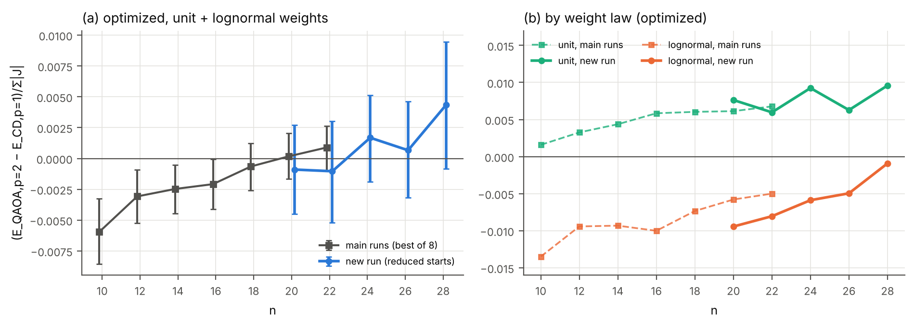

# Side check: CD p=1 vs QAOA p=2 beyond n = 22

### T13. New run (unit + lognormal weights, reduced starts): CD p=1 vs QAOA p=2 by n

`tables/T13_largen_by_n.csv`

| n     |   graphs |   gain_opt |   opt_lo |   opt_hi |   cd_win_opt |   gain_fixed |   fixed_lo |   fixed_hi |   cd_win_fixed |   transfer_loss_cd1 |   gain_cd1_vs_qaoa1_opt |   seconds_per_graph |
|:------|---------:|-----------:|---------:|---------:|-------------:|-------------:|-----------:|-----------:|---------------:|--------------------:|------------------------:|--------------------:|
| 20    |      100 |    -0.0009 |  -0.0045 |   0.0027 |       0.4900 |      -0.0032 |    -0.0088 |     0.0024 |         0.4300 |              0.0127 |                  0.1197 |              4.9130 |
| 22    |      100 |    -0.0010 |  -0.0052 |   0.0030 |       0.5000 |      -0.0009 |    -0.0064 |     0.0046 |         0.4500 |              0.0122 |                  0.1200 |              5.7438 |
| 24    |      100 |     0.0017 |  -0.0019 |   0.0051 |       0.5300 |       0.0003 |    -0.0048 |     0.0056 |         0.4800 |              0.0118 |                  0.1229 |             35.0157 |
| 26    |      100 |     0.0007 |  -0.0032 |   0.0046 |       0.5100 |      -0.0024 |    -0.0083 |     0.0034 |         0.4500 |              0.0121 |                  0.1175 |            160.6914 |
| 28    |       40 |     0.0043 |  -0.0009 |   0.0095 |       0.5500 |       0.0018 |    -0.0072 |     0.0110 |         0.5500 |              0.0123 |                  0.1251 |            729.1305 |
| 24-28 |      240 |     0.0017 |  -0.0006 |   0.0040 |       0.5250 |      -0.0006 |    -0.0040 |     0.0032 |         0.4792 |              0.0120 |                  0.1210 |            203.0664 |

### T13b. New run: optimized gain by family and n

`tables/T13b_largen_by_family.csv`

| family    |     n20 |     n22 |     n24 |     n26 |     n28 |
|:----------|--------:|--------:|--------:|--------:|--------:|
| tree      | -0.0233 | -0.0345 | -0.0139 | -0.0344 | -0.0198 |
| ring      |  0.0062 |  0.0058 |  0.0062 |  0.0148 |  0.0226 |
| regular3  |  0.0022 |  0.0030 |  0.0053 |  0.0071 |  0.0078 |
| regular4  |  0.0064 | -0.0009 |  0.0036 |  0.0030 |  0.0064 |
| regular5  |  0.0055 |  0.0058 |  0.0067 |  0.0037 |  0.0047 |
| regular6  |  0.0012 |  0.0037 |  0.0027 |  0.0019 |  0.0062 |
| er3       | -0.0047 | -0.0078 | -0.0069 | -0.0039 | -0.0011 |
| er05      | -0.0123 | -0.0092 | -0.0091 | -0.0099 | -0.0097 |
| community | -0.0077 | -0.0051 | -0.0035 | -0.0053 | -0.0035 |
| bipartite |  0.0175 |  0.0290 |  0.0257 |  0.0297 |  0.0298 |

### T13c. Optimized gain by weight law: main runs (best of 8) and new run

`tables/T13c_largen_by_weight.csv`

|       n |   main_bimodal |   main_heavy_tail |   main_lognormal |   main_uniform |   main_unit |   new_lognormal |   new_unit |
|--------:|---------------:|------------------:|-----------------:|---------------:|------------:|----------------:|-----------:|
| 10.0000 |        -0.0076 |           -0.0233 |          -0.0135 |        -0.0025 |      0.0016 |        nan      |   nan      |
| 12.0000 |        -0.0025 |           -0.0210 |          -0.0094 |         0.0035 |      0.0033 |        nan      |   nan      |
| 14.0000 |        -0.0021 |           -0.0212 |          -0.0093 |         0.0020 |      0.0044 |        nan      |   nan      |
| 16.0000 |        -0.0000 |           -0.0190 |          -0.0100 |         0.0041 |      0.0058 |        nan      |   nan      |
| 18.0000 |        -0.0015 |           -0.0154 |          -0.0073 |         0.0026 |      0.0060 |        nan      |   nan      |
| 20.0000 |         0.0018 |           -0.0165 |          -0.0058 |         0.0053 |      0.0061 |         -0.0094 |     0.0076 |
| 22.0000 |         0.0024 |           -0.0177 |          -0.0050 |         0.0053 |      0.0068 |         -0.0080 |     0.0060 |
| 24.0000 |       nan      |          nan      |         nan      |       nan      |    nan      |         -0.0059 |     0.0092 |
| 26.0000 |       nan      |          nan      |         nan      |       nan      |    nan      |         -0.0050 |     0.0063 |
| 28.0000 |       nan      |          nan      |         nan      |       nan      |    nan      |         -0.0009 |     0.0096 |

### T13d. Main runs: reduced start set (as in the new run) vs best of 8 starts

`tables/T13d_protocol_check.csv`

|       n |   full_all |   reduced_all |   full_unit_lognormal |   reduced_unit_lognormal |   graphs_unit_lognormal |   reduced_minus_full |
|--------:|-----------:|--------------:|----------------------:|-------------------------:|------------------------:|---------------------:|
| 10.0000 |    -0.0091 |       -0.0085 |               -0.0059 |                  -0.0057 |                400.0000 |               0.0003 |
| 12.0000 |    -0.0052 |       -0.0049 |               -0.0031 |                  -0.0030 |                400.0000 |               0.0001 |
| 14.0000 |    -0.0052 |       -0.0049 |               -0.0025 |                  -0.0023 |                400.0000 |               0.0001 |
| 16.0000 |    -0.0038 |       -0.0036 |               -0.0021 |                  -0.0021 |                400.0000 |               0.0000 |
| 18.0000 |    -0.0031 |       -0.0031 |               -0.0006 |                  -0.0006 |                400.0000 |               0.0000 |
| 20.0000 |    -0.0018 |       -0.0016 |                0.0002 |                   0.0002 |                400.0000 |               0.0000 |
| 22.0000 |    -0.0016 |       -0.0015 |                0.0009 |                   0.0010 |                400.0000 |               0.0001 |

### T13e. Trend of the optimized gain with n (family and weight-law fixed effects, bootstrap 95% CI)

`tables/T13e_largen_trend.csv`

| data                                |   graphs |   slope_per_qubit |      lo |      hi |
|:------------------------------------|---------:|------------------:|--------:|--------:|
| new run, n=20-28                    |      440 |           0.00052 | 0.00005 | 0.00094 |
| main runs, n=10-22 (unit+lognormal) |     2800 |           0.00051 | 0.00034 | 0.00068 |
| main runs, n=16-22 (unit+lognormal) |     1600 |           0.00049 | 0.00017 | 0.00080 |
| main runs, n=10-22 (all weights)    |     7000 |           0.00056 | 0.00044 | 0.00067 |

